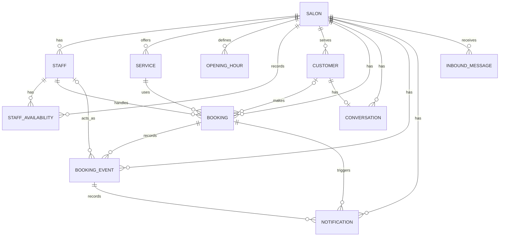

# Shaveshop

WhatsApp barber booking MVP, based on Booking_App_MVP_PRD.docx (4 October 2026).

## Step 1: data models

Rails 8.1 with PostgreSQL. Models: Salon, Staff, Service, OpeningHour,
StaffAvailability, Customer, Booking, Conversation, BookingEvent, InboundMessage,
and Notification.

Staff login identity uses email and a bcrypt password digest, scoped to a salon.
The owner role can also receive bookings. Authentication screens and permissions
are a later step.

Salon defaults are Africa/Nairobi, KES, a 30-day booking horizon, a 15-minute slot
grid, and a 10-minute no-show grace period. Money fields store integer minor
units (KSh 500 = 50,000). Rails stores datetime values in UTC. Opening hours use
local times; availability uses UTC intervals plus a local date.

Booking `service_date` is derived in the salon timezone to support the unique
active customer booking per local day. Snapshot values are supplied by the future
booking workflow and remain independent of service configuration. Queue position
is deliberately not stored.

Database constraints protect active booking ranges, one in-progress booking per
barber, customer/day uniqueness, notification/message deduplication, and matching
salon ownership across related records. Half-open ranges permit adjacent slots.
Referenced history is protected from deletion; deactivate staff and services.

## Schema relationships

`||` means exactly one, `o|` means zero or one, and `o{` means zero or many.



Bookings require a salon, staff member, and service. The customer association is
optional for walk-ins, while WhatsApp bookings require a customer. Each customer
can have at most one conversation per salon. An inbound message is associated
with a salon, but is not directly associated with a customer.

## Setup

Requires Ruby 3.3.3 and PostgreSQL with the btree_gist extension available.

```sh
bundle install
bin/rails db:create db:migrate
bin/rails test test/models test/services
```

Use `DATABASE_URL` for a custom database connection, or PostgreSQL's `PGHOST`,
`PGPORT`, and `PGUSER` environment variables. The migration creates btree_gist,
so the database role must have permission to enable that extension.

The model tests cover snapshots, shop ownership, overlapping and adjacent
reservations, active customer/day uniqueness, and one in-progress service. The
availability service tests cover slot boundaries, staff availability, booking
conflicts, and the booking horizon.

## Later steps

The `Availability::SlotFinder` service generates staff-specific slots by
intersecting salon opening hours, staff availability for the local date, and
active bookings. It steps from opening time by the salon's configured slot grid,
uses the service duration, excludes current and past slots, and permits booking
through the date `booking_horizon_days` ahead (inclusive). Staff availability
records are required for a staff member to have bookable slots on a date.

Slot assignment and booking creation, guarded status transitions, transactional
audit/outbox creation, queue calculation, dashboard authentication
and authorization, WhatsApp conversations, provider integration, and durable jobs
remain to be implemented. Enums define stored states; they do not yet implement
the booking state machine. Timing, opening-hours, and queue-order guards belong
in those booking workflows.
