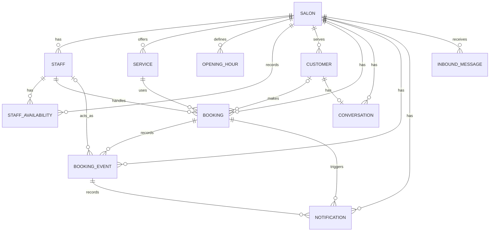

# Shaveshop

WhatsApp barber booking MVP, based on Booking_App_MVP_PRD.docx (4 October 2026).

## Step 1: data models

Rails 8.1 with PostgreSQL. Models: Salon, Staff, Service, OpeningHour,
StaffAvailability, Customer, Booking, Conversation, BookingEvent, InboundMessage,
and Notification.

Staff login identity uses email and a bcrypt password digest, scoped to a salon.
The owner role can also receive bookings. Authentication screens and permissions
are a later step.

Salon defaults are Africa/Nairobi, KES, a 30-day booking horizon, a 15-minute slot
grid, and a 10-minute no-show grace period. Money fields store integer minor
units (KSh 500 = 50,000). Rails stores datetime values in UTC. Opening hours use
local times; availability uses UTC intervals plus a local date.

Booking `service_date` is derived in the salon timezone to support the unique
active customer booking per local day. Snapshot values are supplied by the future
booking workflow and remain independent of service configuration. Queue position
is deliberately not stored.

Database constraints protect active booking ranges, one in-progress booking per
barber, customer/day uniqueness, notification/message deduplication, and matching
salon ownership across related records. Half-open ranges permit adjacent slots.
Referenced history is protected from deletion; deactivate staff and services.

## Schema relationships

`||` means exactly one, `o|` means zero or one, and `o{` means zero or many.



Bookings require a salon, staff member, and service. The customer association is
optional for walk-ins, while WhatsApp bookings require a customer. Each customer
can have at most one conversation per salon. An inbound message is associated
with a salon, but is not directly associated with a customer.

## Setup

Requires Ruby 3.3.3 and PostgreSQL with the btree_gist extension available.

```sh
bundle install
bin/rails db:create db:migrate
bin/rails test
```

Use `DATABASE_URL` for a custom database connection, or PostgreSQL's `PGHOST`,
`PGPORT`, and `PGUSER` environment variables. The migration creates btree_gist,
so the database role must have permission to enable that extension.

The tests cover domain constraints, availability, booking creation, central salon
selection, QR/link generation, and webhook intake.

## Later steps

The platform uses one central WhatsApp Business number. Set `WHATSAPP_BUSINESS_NUMBER`
to that number in international digits without a leading `+` (for example,
`254700000000`) and `WHATSAPP_PHONE_NUMBER_ID` to its Meta phone number ID. Each salon
has a unique `booking_code`; `Salon#booking_link` builds its `wa.me` link and
`Salon#booking_qr_svg` generates a standalone SVG QR code for that link. The link
prefills `BOOK <CODE>` and the customer still has to press Send. These methods are
available now; the owner dashboard that will display them is a later stage.

Configure these additional variables for the webhook:

- `WHATSAPP_APP_SECRET`: Meta app secret, used to verify `X-Hub-Signature-256`.
- `WHATSAPP_WEBHOOK_VERIFY_TOKEN`: a secret string you choose and enter in Meta's webhook setup.
- `WHATSAPP_ACCESS_TOKEN`: token authorized to send from the central business number.

In the Meta app's WhatsApp webhook configuration, use the public HTTPS URL
`https://<your-host>/webhooks/whatsapp`, enter the same verify token, and subscribe to
the `messages` field. Meta calls GET to verify the endpoint; incoming POSTs are checked
against the app secret, deduplicated by provider message ID, then queued for processing.
The receiver ignores events for phone number IDs other than `WHATSAPP_PHONE_NUMBER_ID`.

To inspect a salon's shareable link and QR in the Rails console:

```ruby
salon = Salon.find_by!(booking_code: "ABC123")
salon.booking_link
File.write("tmp/#{salon.booking_code}.svg", salon.booking_qr_svg)
```

For local webhook testing, expose the Rails server through an HTTPS tunnel and use that
public URL as the Meta callback. Unit and integration tests run without Meta credentials
with `bin/rails test`. Salon identification is implemented; the interactive appointment
booking conversation is the next stage.

The `Availability::SlotFinder` service generates staff-specific slots by
intersecting salon opening hours, staff availability for the local date, and
active bookings. It steps from opening time by the salon's configured slot grid,
uses the service duration, excludes current and past slots, and permits booking
through the date `booking_horizon_days` ahead (inclusive). Staff availability
records are required for a staff member to have bookable slots on a date.

`Bookings::Create` rechecks a selected staff member's slot under a row lock, then
creates a confirmed booking with price and duration snapshots and a `booking_created`
audit event in one transaction. PostgreSQL overlap constraints remain the final guard.
The service accepts a customer, service, staff member, start time, optional customer
name/source, and an injectable current time. It does not yet expose a web or WhatsApp
interface.

`Bookings::Transition` handles arrival (`confirmed` to `waiting`), start (`waiting` to
`in_progress`), and completion (`in_progress` to `completed`). Each change locks the
booking, checks its current state and timing, updates its timestamp, and records an
audit event in one transaction. Starting also locks the staff member and translates
the one-service-per-barber database constraint into an invalid transition.

`Bookings::Queue` returns the current service, waiting bookings ordered by scheduled
slot time, and confirmed bookings ordered by scheduled time for one barber and local
service date. Queue positions are calculated from scheduled time, not arrival time.
Starting service is restricted to the first waiting booking. Walk-ins book an available
slot through `Bookings::Create` and join the same queue after check-in; they do not use
a separate queue.

`Notifications::Enqueue` creates a deduplicated notification record in the same
transaction as supported booking events, then schedules delivery after commit. It
snapshots confirmation and queue-update text; queue updates are suppressed when the
customer's preference is disabled. `Notifications::DeliverJob` sends through
`Whatsapp::CloudApi`, retries transient failures up to five attempts, and records the
provider message ID and accepted/failed state. A delivery receipt webhook is still
needed to move accepted messages to delivered.

Set `WHATSAPP_ACCESS_TOKEN`, `WHATSAPP_PHONE_NUMBER_ID`, and
`WHATSAPP_BUSINESS_NUMBER`; optionally set `WHATSAPP_GRAPH_API_VERSION` (defaults to
`v27.0`). Within 24 hours of a customer's last inbound message, delivery uses a text
message. Outside that customer service window, configure an approved utility template
with one body parameter (`{{1}}`) using `WHATSAPP_UTILITY_TEMPLATE_NAME`; set its
locale with `WHATSAPP_TEMPLATE_LANGUAGE` (defaults to `en`). Keep credentials in environment
configuration, not source control. Production uses Solid Queue; prepare its queue
database and run `bin/jobs` alongside the web process.

The central webhook, idempotent inbound storage, asynchronous salon identification, and
salon switching are in place. The interactive WhatsApp booking flow, delivery receipt
webhooks, reminders, and dashboard authentication remain to be implemented. After a
no-show, the newly open time should be offered to customers with later bookings when
their service fits; an acceptance must recheck availability and claim the time
transactionally. Enums define stored states; they do not by themselves implement the
remaining booking state machine.
